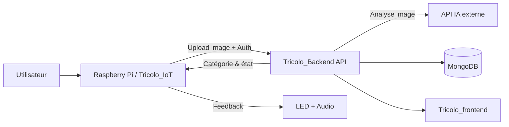

# Tricolo — Plateforme IoT de tri intelligent des déchets


##  À propos

**Tricolo** est un projet IoT de tri des déchets composé de 3 briques :

- un **système embarqué** (Raspberry Pi) qui capture et envoie des images de déchets ;
- un **backend** qui gère l’API, la persistance, la logique métier et l’analyse IA ;
- un **frontend** qui affiche les données, statistiques et états des bacs.

Le dépôt actuel est le **repository parent** qui assemble ces composants via des **Git submodules**.

---

##  Sous-modules du projet

| Module | Rôle | Lien |
|---|---|---|
| `Tricolo_IoT` | Capture photo, interaction matérielle (bouton, LED, capteur), envoi vers API backend, retour audio/visuel | [Andylamothe/Tricolo_IoT](https://github.com/Andylamothe/Tricolo_IoT) |
| `Tricolo_Backend` | API Node/TypeScript, auth, stockage MongoDB, endpoints IoT & frontend, analyse d’image via API IA externe (Gemini) | [Andylamothe/Tricolo_Backend](https://github.com/Andylamothe/Tricolo_Backend) |
| `Tricolo_frontend` | Interface React/Vite (dashboard), affichage des données de tri, statistiques, monitoring des bacs | [Andylamothe/Tricolo_frontend](https://github.com/Andylamothe/Tricolo_frontend) |

---

##  Vue d’ensemble fonctionnelle

1. L’utilisateur dépose un déchet et déclenche la borne IoT.
2. Le module IoT capture une image et l’envoie au backend.
3. Le backend analyse l’image via une API externe d’IA, puis détermine la catégorie.
4. Le backend enregistre les données (déchet, date, vérification, statistiques, notifications).
5. Le frontend consomme les endpoints backend pour afficher l’état système en temps réel et l’historique.
6. Le module IoT récupère la catégorie, guide l’utilisateur (LED + audio) et valide la destination du déchet.

---

##  Composants et versions

Les versions ci-dessous correspondent aux manifestes et à la documentation des sous-modules. Utilisez de préférence les versions LTS recommandées pour l’environnement d’exécution.

| Composant | Version / exigence | Utilisation |
|---|---|---|
| Python | 3.x (version non verrouillée ; Python 3.11+ recommandé) | Application embarquée Raspberry Pi |
| Node.js | 20.19+ ou 22.12+ | Backend et frontend |
| npm | Version fournie avec Node.js | Installation des dépendances JavaScript |
| TypeScript | 5.9.x | Backend |
| JavaScript / JSX | ES2020+ / JSX | Frontend React et scripts backend |
| React | 19.2.x | Interface web |
| Vite | 7.2.x | Développement et build frontend |
| Express | 5.2.x | API backend |
| MongoDB / Mongoose | Mongoose 8.18.x | Persistance des données |
| Raspberry Pi OS | Version récente compatible avec Python 3 | Exécution IoT |

### Dépendances matérielles IoT

Le fonctionnement complet de `Tricolo_IoT` nécessite :

- un Raspberry Pi ;
- une caméra compatible `Picamera2` ;
- un bouton poussoir ;
- deux LED RGB et les résistances/câblage adaptés ;
- un système audio compatible avec `mpg123` ;
- une connexion réseau vers le backend.

### Services et configuration

Le fonctionnement de bout en bout nécessite également :

- une base de données MongoDB ;
- un accès à l’API d’analyse d’image configurée dans le backend ;
- les identifiants et secrets définis dans `Tricolo_Backend/src/config/.env.example` ;
- une URL de backend accessible par le Raspberry Pi et le frontend.

Les dépendances Python et JavaScript détaillées sont documentées dans les README et manifestes de chaque sous-module. Installez-les depuis les répertoires concernés avec `npm install` pour le backend/frontend et `pip` selon les dépendances IoT nécessaires.

---

##  Architecture (haut niveau)



---

##  Démarrage rapide (repo parent)

```bash
git clone https://github.com/Andylamothe/Tricolo.git
cd Tricolo
git submodule update --init --recursive
```

Ensuite, lancez chaque module selon sa documentation propre :

- `Tricolo_IoT/README.md`
- `Tricolo_Backend/README.md`
- `Tricolo_frontend/README.md`

---

##  Contribuer

Les contributions sont les bienvenues : correction de bugs, amélioration de la documentation, nouvelles fonctionnalités et retours d’expérience.

1. Consultez [`CONTRIBUTING.md`](./.github/CONTRIBUTING.md).
2. Ouvrez une issue pour discuter d’un changement important.
3. Créez une branche dédiée et soumettez une pull request.

Avant de contribuer à un sous-module, vérifiez également ses règles et sa licence propres. Ce dépôt parent référence les trois composants comme des dépôts indépendants ; chaque sous-module doit donc être publié et maintenu sous une licence compatible séparément.

---

##  Collaborateurs

Contributeurs identifiés à partir de l’historique Git du projet et des sous-modules :

- **Andy Lamothe** (mainteneur principal)
- **Samuel Robillard**
- **Bradley Leneus**
- **Alexandre Rusenov**

Contributions automatisées (bots) observées dans l’historique :

- `copilot-swe-agent[bot]`
- `vercel[bot]`

---

##  Photos du projet

### Frontend (dashboard)


### Projet (borne / démonstration)


### Équipe


---

##  Licence

Le dépôt parent est distribué sous licence **MIT**. Voir [`LICENSE`](./LICENSE).

Les sous-modules sont des dépôts indépendants et peuvent avoir leurs propres conditions de licence. Consultez leur fichier `LICENSE` avant de réutiliser leur contenu.
